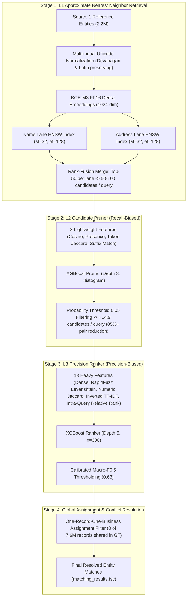

# Scalable Business Entity Resolution at Trillion-Scale

[](https://www.python.org/downloads/)
[](https://github.com/facebookresearch/faiss)
[-orange.svg)](https://huggingface.co/BAAI/bge-m3)
[](https://xgboost.ai/)
[-red.svg)](https://cloud.google.com/vertex-ai)
[](https://opensource.org/licenses/MIT)

An end-to-end, production-grade Machine Learning pipeline for **multilingual, large-scale Business Entity Resolution (ER)** across noisy, unstructured data sources with zero shared identifiers.

Engineered to resolve millions of reference entities (Source 1) against a massive candidate pool (Sources 2 & 3) across an astronomical **22.8 trillion pair search space** ($2.2\text{M} \times 10.3\text{M}$ records) under strict single-node GPU memory and compute budgets.

---

## Architecture Overview

The system bypasses the impossible $O(N^2)$ brute-force bottleneck by operating as an asymmetric, high-efficiency cascading funnel:



### Funnel Progression & Complexity

| Stage | Mechanism | Input Scale | Output Scale | Primary Metric & Design Objective |
| :--- | :--- | :--- | :--- | :--- |
| **L1 Retrieval** | Dual-Lane FAISS HNSW + BGE-M3 (0.5B) | 22.8T pairs (2.2M × 10.3M) | 50–100 cands/query | **Recall Ceiling**: 94.3% candidate recall (US: 96.4%, India: 91.3%); $O(\log N)$ ANN search; memory-mapped (`IO_FLAG_MMAP`). |
| **L2 Pruner** | Lightweight XGBoost (`max_depth=3`) | 50–100 cands/query (~150M pairs) | ~14.9 cands/query (~33M pairs) | **Candidate Compression**: Cuts candidate space by >80% at $\tau = 0.05$ while retaining 94.2% recall before expensive string algorithms. |
| **L3 Ranker** | Precision XGBoost (`max_depth=5`, 13 feats) | ~14.9 cands/query | Definite matches | **Precision-Weighted Macro $F_{0.5}$**: Macro $F_{0.5} = 0.9082$, 97.1% micro-precision, 88.5% singleton accuracy. |
| **Post-Processing** | Bipartite Winner-Take-All Assignment | Scored candidates | Disjoint assignments | **Domain Invariant**: Ground truth verifies 0 of 7.6M true records belong to multiple entities. High-confidence owner retains candidate ($\Delta +0.0004$). |

---

## Cloud Infrastructure & Hardware Setup

All full-scale training, indexing, and evaluations were executed on a single cloud GPU instance:

* **Platform**: Google Cloud Platform (GCP) **Vertex AI Workbench** User-Managed Notebook.
* **Instance Type**: `g2-standard-16` (16 vCPUs, 64 GB Host RAM).
* **Accelerator**: 1× **NVIDIA L4 GPU** (24 GB GDDR6 VRAM, Ada Lovelace architecture).
* **Storage Architecture**: 500 GB Balanced Persistent Disk (`pd-balanced`).
* **Memory-Mapped Indexing**: Rather than loading the **180 GB FAISS HNSW indices** (`candidates_name_hnsw.index` and `candidates_addr_hnsw.index`) into system RAM, indices are memory-mapped via OS page caching (`faiss.IO_FLAG_MMAP`), requiring **zero active host RAM** until queried.
* **Asset Storage Tiering**:
  * Public code & lightweight models (<2 MB): GitHub & Hugging Face Model Hub.
  * Intermediate feature caches & raw datasets (~2.5 GB): Hugging Face Dataset Hub.
  * Massive pre-built 180 GB indices: GCP Persistent Disk / Cloud Storage (`gs://`).

---

## Empirical Benchmark Results

Evaluated against a clean, held-out universe of **315,196 Source 1 entities** using a deterministic **70% Train / 15% Tune / 15% Holdout hash split** (zero leakage; diagnostic design seeds 42 and 43 pinned to Train):

### 1. Overall System Performance

| Metric | Measured Value | Benchmark Description |
| :--- | :--- | :--- |
| **Macro $F_{0.5}$** | **0.9082** (95% CI: 0.9075 – 0.9089) | Primary objective metric (precision weighted $2\times$ over recall) |
| **With One-Owner Step** | **0.9087** ($\Delta +0.0004$) | Post-processed lower-bound under disjoint assignment |
| **Floor / Ceiling** | **0.0563 / 0.9788** | "Predict nothing" (singleton rate) vs perfect ranker on candidate set |
| **Candidate Set Recall (L1+L2)** | **94.3%** | Upper bound recall surviving into the candidate set |
| **Final System Recall** | **82.3%** | End-to-end recall after precision filtering |
| **Micro Precision** | **97.1%** | Precision across all predicted positive pairs |
| **Singleton Accuracy** | **88.5%** | Correctly predicted empty for entities with zero true matches |
| **Calibration Error (ECE)** | **0.0029** | Expected Calibration Error across 10 probability bins |
| **Average Candidate Count** | **14.9** (median 12, P95 39, max 100) | Candidate set parsimony |

### 2. Segmented Breakdown (Holdout)

| Segment Category | Subgroup | Entity Count | Macro $F_{0.5}$ |
| :--- | :--- | :---: | :---: |
| **Country Domain** | `US` | 189,191 | **0.9208** |
| | `India` (Multilingual / Non-standard) | 126,005 | **0.8893** |
| **True Match Cardinality** | `0` (Singletons) | 17,745 | **0.8854** |
| | `1` match | 16,902 | **0.7836** |
| | `2–3` matches | 129,644 | **0.9024** |
| | `4–5` matches | 115,084 | **0.9280** |
| | `≥6` matches | 35,821 | **0.9361** |
| **Candidate List Size** | `1–9` candidates | 121,928 | **0.9020** |
| | `10–19` candidates | 122,879 | **0.9170** |
| | `≥20` candidates (fat tail) | 70,318 | **0.9040** |

---

## Engineering Insights & Caught Failure Modes

During iterative development, empirical measurements caught several critical bugs that looked like success on paper:

1. **The Unicode Normalization Mismatch (The Big One)**:
   * **Failure**: Candidate FAISS index was built using Polars (Rust regex), while query encoding used standard Python `re.sub(r"[^\w\s]")`.
   * **Root Cause**: Python's `\w` strips Unicode marks (`Mn`, `Mc` combining characters/matras in Devanagari), whereas Rust's `\w` preserves them.
   * **Impact**: A stored embedding vs a fresh query encode of the exact same Hindi business record had a cosine similarity of only **0.52**.
   * **Fix**: Unifying Unicode normalization in [`src/core/text.py`](src/core/text.py) restored cosine similarity to **≈1.000**, jumping absolute Indian recall from 88.6% to **90.9%** and US recall from 93.9% to **96.4%**.
2. **Memory Walls & Avoided Crashes**:
   * **157 GB RAM Crash**: Scikit-Learn TF-IDF `.toarray()` on 10M rows blew up memory. Fixed by writing a zero-RAM dictionary inverted IDF counter ([`src/core/similarity.py`](src/core/similarity.py)).
   * **186 GB VRAM Crash**: Naive GPU matrix multiplication on $50\text{k} \times 2\text{M}$ candidate vectors failed. Bypassed by chunked FAISS HNSW graph search.
   * **78 GB Vector Cache Crash**: Loading reconstructed embeddings into Python dictionaries crashed host memory. Replaced by querying embeddings on-the-fly directly from memory-mapped indices (`index.reconstruct(row_idx)`).
3. **The 8.3% Token-Join Trap**:
   * An exact rare-token join lane was assumed to be 99.999% precise "by construction". Measured precision was only **8.3%** because street numbers and developer names collide frequently across independent cities. The lane was dropped.
4. **FAISS Distance Metric Inversion**:
   * FAISS `IndexHNSWFlat` defaults to squared Euclidean distance ($L_2^2$). When feeding scores as "cosine" to ML rankers, values were inverted until properly transformed via $\text{cos} = 1 - \frac{L_2^2}{2}$.

---

## Repository Structure

```
.
├── src/
│   ├── core/                        # Single source of truth for text & similarity
│   │   ├── text.py                  # Unicode-safe normalizer & legal suffix strip
│   │   └── similarity.py            # Token Jaccard, numeric Jaccard, RapidFuzz, TF-IDF
│   ├── models/                      # ML Model definitions
│   │   ├── l2_pruner.py             # 8-feature recall-biased XGBoost pruner
│   │   └── l3_ranker.py             # 13-feature precision XGBoost ranker + conflict resolution
│   └── pipeline/                    # Unified pipeline runners
│       ├── build_index.py           # Parameterized dual-lane FAISS HNSW builder
│       └── predict.py               # End-to-end inference engine with checkpoints
├── scripts/
│   ├── quickstart_demo.py           # 30-second local CPU smoke test (zero data needed)
│   ├── download_assets.py           # Hugging Face Hub asset downloader
│   └── setup_gcp_vm.sh              # GCP Vertex AI Workbench provisioning script
├── tests/
│   ├── test_text.py                 # Unit tests for Devanagari & legal suffix parity
│   ├── test_similarity.py           # Unit tests for string metrics & Macro F0.5
│   └── test_models.py               # Unit tests for L2 pruner & L3 ranker logic
├── docs/
│   ├── PROJECT_REPORT.md            # Comprehensive 165-line empirical engineering report
│   ├── CHALLENGE_PROMPT.md          # Formal competition specification & constraints
│   ├── eval_results.json            # Exact holdout evaluation JSON dump
│   └── eval_summary.png             # Evaluation diagnostic visualization
├── evaluate_pipeline.py             # Flagship 70/15/15 hash split evaluation harness
├── requirements.txt                 # Pinned dependencies
└── README.md                        # Documentation
```

---

## Quickstart & Reproduction Guide

### Track 1: 30-Second Local CPU Demo (Zero Setup Required)
Test and verify the entire 3-stage cascading pipeline locally on synthetic business records:
```bash
# 1. Clone repository
git clone https://github.com/mdumr4/Business-Entity-Resolution.git
cd Business-Entity-Resolution

# 2. Setup virtual environment
python3 -m venv venv
source venv/bin/activate  # On Windows: venv\Scripts\activate
pip install -r requirements.txt

# 3. Run the local demo (runs in ~0.5s on CPU)
python scripts/quickstart_demo.py
```

### Track 2: Sync Assets from Hugging Face Bucket
Download pre-trained models (<2 MB) and precomputed feature matrices (~1.5 GB) from the official Hugging Face Bucket:
```bash
# Sync golden assets from Hugging Face Storage Bucket into output/
hf sync hf://buckets/mdumr4/Business-Entity-Resolution output

# Or run the downloader wrapper
python scripts/download_assets.py

```

### Track 3: Run Full Evaluation Harness
Evaluate the ranker on 315,196 clean held-out entities using the deterministic hash split:
```bash
python evaluate_pipeline.py --device cpu
```

### Track 4: Cloud Training & Inference from Scratch (GCP Vertex AI / NVIDIA L4)
To run the full end-to-end pipeline from raw data:
```bash
# 1. Provision GCP VM
bash scripts/setup_gcp_vm.sh

# 2. Build Dual-Lane FAISS HNSW Indices (~2 hours on GPU)
python src/pipeline/build_index.py --split train

# 3. Run full cascading funnel (L1 retrieval -> L2 pruner -> L3 features -> ranking)
python src/pipeline/predict.py --split train

# 4. Evaluate and save models with zero-leakage hash splitting
python evaluate_pipeline.py --ablate --transfer --save-model

```

---

## Unit Testing & Verification

Run the test suite to verify Unicode parity, string metrics, and model behaviors:
```bash
python -m unittest discover -s tests -p "test_*.py"
```

---

## License

This project is licensed under the [MIT License](LICENSE).
The embedding model used ([`BAAI/bge-m3`](https://huggingface.co/BAAI/bge-m3)) is licensed under the Apache 2.0 License.
